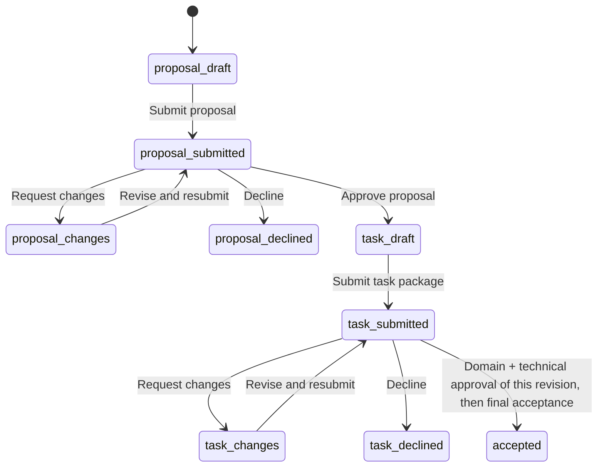

# Contribution and review workflow

## Scope

The contribution module supports preparing a scientific task, submitting its
materials, reviewing a specific revision, and recording an acceptance decision.
Its endpoint is **Accepted — awaiting integration**: the task package is accepted
for later integration. Acceptance does not mean that an experiment has run, that
its results are validated, or that a leaderboard entry has been published.

This is a local browser demonstration. IndexedDB stores records in the current
browser profile and site origin; it does not send a submission to AISLE or provide
shared storage, verified accounts, reviewer permissions, or a secure audit trail.
Clearing browser data can remove the records. Contributor and reviewer views
demonstrate workflow roles, not access controls. Shared review requires a deployed
backend with authentication, authorization, and durable storage.

## Four questions for a proposal

1. **What scientific problem should the task address?** Describe the question,
   its scientific value, and the intended outcome.
2. **What must the AI scientist decide?** Describe the actions or choices the AI
   can make, its available inputs, and the constraints on its decisions.
3. **What feedback informs its next action?** Describe the observations returned
   to the AI, when they arrive, and how they support choosing the next step.
4. **How will the outcome and decisions be assessed?** Describe measurable
   criteria or a documented review rubric, supporting evidence, and how
   repeatability, uncertainty, and experimental error will be handled.

These questions apply across computational and experimental work, including wet
experiments. Proposals are not restricted to the existing study's task categories.
A unique reference answer is not required: valid evaluation can use constraints,
measured outcomes, comparative performance, or a clear evidence-based rubric.
Negative or inconclusive results can still be scientifically useful.

## Submission materials

Start with contributor or team details, contact information, a title, answers to
the four questions, and available resources or support needed. Proposal review
does not require a complete task package. After the proposal is approved, prepare:

- Participant instructions, concrete inputs or an access plan, allowed actions,
  feedback formats, required outputs, constraints, budgets, and stopping rules.
- A computational procedure or experimental protocol, dependencies, execution
  responsibility, and resource access. For laboratory execution, describe the
  operator, capacity, indicative schedule, and how observations return to the AI.
- Relevant data, code, example inputs, protocols, and supporting references as
  attachments or links; identify versions and any access restrictions.
- An evaluation plan, including applicable controls, repeats, tolerances,
  uncertainty reporting, and baseline or reference material where useful.
- Material provenance and permissions for use and sharing; applicable laboratory
  safety, ethics, or regulatory prerequisites for the proposed execution.
- Requested credit, a proposed public summary, and visibility rules separating
  participant materials, reviewer-only documents, hidden references, and embargoes.

Materials should be sufficient to assess scientific value, feasibility, and
evaluation quality. Any missing material or unresolved prerequisite should be
identified explicitly for review.

## States and review decisions

Submitted task packages cannot be edited in place. A change request opens
revision work; resubmission produces a new reviewable revision. Domain review
assesses scientific value, meaningful AI decisions, and evaluation criteria.
Technical review assesses inputs, execution, feedback, failure handling, rights,
and visibility. Both must approve the **same submitted revision** before final
acceptance is permitted. Earlier approvals cannot authorize a later revision.
Review comments and decisions belong to the revision they assessed.

The stored `accepted` state is displayed as **Accepted — awaiting integration**.
Integration, public release, execution, and result validation are later workflows.

## Local storage and transfer

The demonstration creates UUIDs locally and saves IndexedDB `records` and `files`
atomically. A JSON export carries submission records and base64-encoded attachments
as an offline transfer package. Exporting does not submit, execute, or publish
anything. It provides a migration input for a future server API; it is not proof
of identity, permission, or reviewer approval.

## Future server boundaries

Submission records need durable persistence **before** any experiment is connected.
A later database also stores experimental feedback after integration; that does
not replace the contribution and review record. Keep these conceptual entities
separate, with explicit links:

- **Contributors:** identity, contact, affiliation, and attribution. Authenticated
  accounts and assigned permissions determine ownership and review access.
- **Proposals:** the scientific idea, contributor links, lifecycle, and proposal
  review history. Approval opens preparation of a task package.
- **Task revisions:** versioned instructions, inputs, actions, feedback contracts,
  evaluation rules, and references to the originating proposal.
- **Attachments:** revision ownership, file metadata, storage references, rights,
  and intended visibility; file bytes can live in separate object storage.
- **Review comments and decisions:** reviewer identity, review domain, revision,
  timestamps, requested changes, and the final acceptance record.
- **Later runs, observations, and feedback:** execution instances linked to an
  integrated task revision; measured or simulated observations and their
  provenance; feedback delivered to the agent and subsequent decisions. Review
  comments are not experimental feedback, and acceptance creates no run result.

The contribution API should own draft updates, submission snapshots, attachment
access, review actions, and acceptance. A separate integration/execution API should
own task deployment, runs, observations, and feedback. Share stable identifiers
and revision references across this boundary. The backend must enforce ownership,
reviewer authorization, visibility, valid transitions, and revision-specific
approval checks; browser controls cannot enforce them. Endpoint names, table
layouts, and transport schemas are implementation choices, not defined here.
